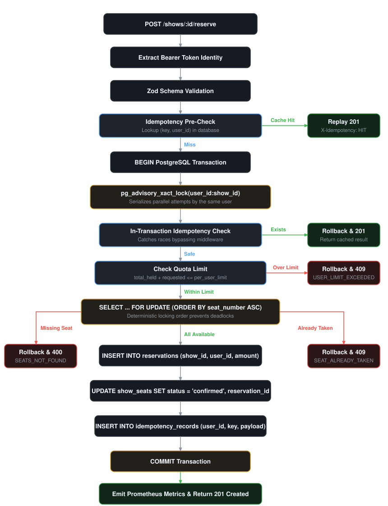

# System Architecture & Technical Design

This document details the concurrency control model, transactional integrity mechanisms, idempotency implementation, and observability patterns used in the seat reservation engine.

---

## Reservation Flow Lifecycle

The following diagram illustrates the transactional flow of a seat reservation request from arrival to final commit:

<p align="center">
  
</p>

---

## Concurrency Model

High-contention ticketing systems face two concurrent race condition challenges:
1. **Seat Contention**: Multiple users attempting to reserve the exact same seat simultaneously.
2. **Quota Race**: A single user attempting parallel requests to bypass purchasing limits.

To solve both challenges cleanly without application-level distributed locks, the system coordinates two distinct PostgreSQL locking mechanisms.

### 1. User-Scoped Advisory Locks (`pg_advisory_xact_lock`)

Before executing seat lookups or inventory modifications, the transaction requests a PostgreSQL transaction-scoped advisory lock keyed on a 32-bit hash of the user and show IDs:

```sql
SELECT pg_advisory_xact_lock(hashtext($1 || ':' || $2));
```

- **Purpose**: Serializes all reservation operations initiated by the same user for a given show.
- **Guarantee**: Prevents parallel transactions from reading stale `COUNT(*)` quota balances before concurrent commits complete.
- **Lifecycle**: Scoped strictly to the transaction (`_xact_`), releasing automatically upon `COMMIT` or `ROLLBACK` without requiring manual lock management.

### 2. Deterministic Row-Level Locking (`SELECT ... FOR UPDATE`)

Seat reservation state is guarded using row-level exclusive locks:

```sql
SELECT id, seat_number, status
FROM show_seats
WHERE show_id = $1 AND seat_number = ANY($2::text[])
ORDER BY seat_number ASC
FOR UPDATE;
```

- **Conflict Resolution**: When multiple transactions contest the same seat, exactly one acquires the lock. Competing transactions block until the first completes, then observe `status = 'confirmed'` and receive a clean `409 Conflict`.
- **Deadlock Prevention**: Sorting seat numbers alphabetically (`ORDER BY seat_number ASC`) establishes a global lock acquisition hierarchy. If User A books `[A1, A2]` and User B books `[A2, A1]`, both acquire `A1` first, eliminating circular wait conditions.

---

## Database Constraints as Defense-in-Depth

Application logic is backed by relational database constraints:

```sql
CREATE TABLE show_seats (
  id UUID PRIMARY KEY DEFAULT gen_random_uuid(),
  show_id UUID NOT NULL REFERENCES shows(id),
  seat_number VARCHAR(50) NOT NULL,
  status seat_status NOT NULL DEFAULT 'available',
  reservation_id UUID REFERENCES reservations(id),
  updated_at TIMESTAMPTZ DEFAULT NOW(),

  UNIQUE (show_id, seat_number),
  CHECK (
    (status = 'available' AND reservation_id IS NULL) OR
    (status = 'confirmed' AND reservation_id IS NOT NULL)
  )
);
```

1. **Unique Seat Index**: `UNIQUE(show_id, seat_number)` guarantees no duplicate seats can ever be created within an event.
2. **State Consistency CHECK**: Enforces that `"available"` seats never point to an active reservation, and `"confirmed"` seats must always reference a valid reservation record. Any application anomaly violating this invariant is rejected at the database engine level.

---

## Idempotency Engine

Network instability often causes clients to retry requests whose status is ambiguous. The service implements safe retry semantics via an `idempotency_records` table.

```sql
CREATE TABLE idempotency_records (
  key VARCHAR(255) NOT NULL,
  user_id VARCHAR(255) NOT NULL,
  show_id UUID NOT NULL REFERENCES shows(id),
  request_hash VARCHAR(64) NOT NULL,
  response_status INT NOT NULL,
  response_body JSONB NOT NULL,
  created_at TIMESTAMPTZ DEFAULT NOW(),
  PRIMARY KEY (user_id, key)
);
```

### Two-Tier Verification

1. **Fast-Path Middleware Check** (`src/middlewares/idempotency.ts`):
   Inspects incoming requests before opening database transactions. If `(user_id, key)` exists in the cache, the original response is replayed immediately with an `X-Idempotency-Cache: HIT` header.
2. **In-Transaction Race Check** (`src/routes/shows.ts`):
   Guards against concurrent requests bearing the identical key that bypassed the middleware simultaneously. Inside the advisory lock, the key is checked a second time before inserting reservations.
3. **Payload Mismatch Validation**:
   The SHA-256 hash of the normalized seat array is persisted alongside the key. If a client attempts to reuse an existing idempotency key with different seat selections, the system rejects the request with `409 Conflict (IDEMPOTENCY_MISMATCH)`.

---

## Observability & Telemetry

The service instruments operational metrics and structured event logs for real-time visibility under load:

| Telemetry Target | Instrument Type | Purpose |
|---|---|---|
| `reservations_confirmed_total` | Prometheus Counter | Tracks total throughput of successful bookings |
| `reservations_declined_total{reason}` | Prometheus Counter | Monitors rejection rates partitioned by cause (`SEAT_ALREADY_TAKEN`, `USER_LIMIT_EXCEEDED`, `IDEMPOTENCY_MISMATCH`) |
| `seats_available_current{show_id}` | Prometheus Gauge | Tracks real-time unreserved seat inventory per event |
| `x-request-id` | HTTP Request Header / Pino Context | Correlates inbound HTTP queries across middleware, transaction blocks, and error traces |
